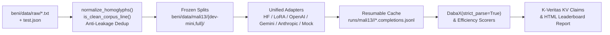

# `MALI13`: Multi-Axis Model Efficiency & Equity Benchmark Across Mali's 13 Languages

## 1. Goal & Motivation

**`MALI13`** is a first-class, reproducible, K-Veritas-attestable evaluation suite inside `sebeni` (`beni/bench/mali13/` + `sebeni bench` CLI) built to measure **how effectively and efficiently language models handle Mali's 13 national languages (`MULTI13`)**:

> `bam` (Bambara), `bmq` (Bomu), `boz` (Bozo), `dtm` (Dogon), `ful` (Fula), `kao` (Kassonke), `mey` (Hassaniya), `mku` (Maninka), `myk` (Mamara), `ses` (Songhay), `snk` (Soninke), `spp` (Supyire), `taq` (Tamasheq).

Evaluating models on ultra-low-resource African languages requires measuring four coupled dimensions simultaneously:
1. **Morphological Fidelity (`M`)**: Structural schema accuracy, dictionary-backed `DabaX(strict_parse=True)` integrity, morpheme edit accuracy, and morphosyntactic stage consistency.
2. **Generation Integrity (`G`)**: Ability to continue Malian prompts coherently without collapsing into French/English code-switching or repetitive degeneration.
3. **Discriminative Language Understanding (`L`, `C`)**: Fine-grained 13-way Language Identification (including confusable Manding and Senufo pairs) and Morphosyntactic Cloze prediction accessible identically to open-weight and closed API models.
4. **Linguistic & Compute Efficiency**:
   - **Tokenizer & LM Efficiency**: Subword fertility, morpheme fertility (`subwords / DabaX morpheme`), bytes per token, **diacritic fragmentation penalty** (`ɛ ɔ ɲ ŋ ɓ ɗ ƴ ă ə ɣ ḍ ḥ ṭ ẓ ʼ`), and tokenizer-invariant **Bits-Per-Byte (`BPB`)**.
   - **Cross-Language Equity (`Q_min3`, `Q_gap`)**: Ensuring high Bambara scores cannot mask failure on `dtm`, `boz`, `taq`, or `mey`.
   - **Compute / Cost Pareto Efficiency**: End-to-end latency (`s/sample`, `tok/s`), active parameter count (`B`), peak CUDA VRAM (`MB`), and estimated API USD cost plotted as Pareto dominance frontiers against `MALI13-Q`.



---

## 2. Dataset Architecture & Anti-Leakage (`beni/data/mali13/`)

All splits are constructed deterministically (`seed=2026`) using our revised 13 `baseline.gram` / `baseline.dict` grammars and the cleaning helpers in `beni/utils/normalize.py`, then frozen as versioned JSONL files accompanied by a SHA-256 `manifest.json`.

### 2.1 Strict Anti-Leakage Invariants
1. **Zero overlap with training/distillation sets**: Every candidate line is homoglyph-normalized and SHA-256 hashed against all **4,200 rows** of `beni/data/raw/dataset_300_samples.jsonl` and **140 rows** of `beni/data/raw/dataset_10_samples.jsonl`. Any exact or near-normalized match is excluded (`overlap == 0` enforced by automated tests).
2. **Training-time guard**: `assert_train_source()` in `beni/data/datasets.py` is extended to reject any path inside `beni/data/mali13/` as a training or distillation input.
3. **Outlier isolation**: `bbo` (Bobo Madaré) remains outside `MULTI13` (`beni/core/language.py`), consistent with `resolve_scope("multi13")`.

### 2.2 Five Frozen Evaluation Splits

Two tiers are packaged: **`dev-mini`** (`728` total rows — fast CI & API smoke checks) and **`full`** (`3,510` total rows — publication benchmark).

| Split File | Axis | `dev-mini` (per lang / total) | `full` (per lang / total) | Selection Criteria & Oracle Fields |
| :--- | :--- | :---: | :---: | :--- |
| `morph.jsonl` | **Morphological Analysis & Glossing** | 10 / 130 | 50 / 650 | Length-stratified (short/medium/long) held-out sentences where `MorphologyScorer.strict_parsed_rate >= 0.85` and `>= 20%` of tokens carry inflected `stage 0` or `stage 1` `DabaX` parses. Stores frozen `ref_morphemes`, `ref_stages`, `ref_strict_rate`, and `n_inflected`. |
| `gen.jsonl` | **Generation Integrity & Purity** | 8 / 104 | 30 / 390 | Held-out 5–8 token native prefixes (`prompt_prefix`) extracted from clean ≥12-token sentences alongside reference continuations for distribution sanity. |
| `lid.jsonl` | **13-Way Language Identification** | 10 / 130 | 50 / 650 | Clean 8–30 word held-out prose targeting high-confusability clusters (`bam`/`mku`/`kao`, `myk`/`spp`, `boz`/`snk`, `mey`/`taq`). |
| `cloze.jsonl` | **Morphosyntactic Cloze (4-Way MCQ)** | 8 / 104 | 40 / 520 | Masks one inflected/derived `DabaX` token (`stage in {0,1}`, `len(morphemes) >= 2`). Supplies 4 options `(A–D)`: 1 gold surface + 3 programmatic distractors (wrong affix/noun-class, bare root stem, confusable-language word). |
| `lm_efficiency.jsonl` | **Tokenizer & LM Compression** | 20 / 260 | 100 / 1,300 | Diverse held-out prose pre-annotated with `utf8_bytes`, `n_words`, `n_dabax_morphemes`, `ascii_tokens`, and `diacritic_tokens` lists. |

#### Representative JSONL Schemas
```json
// morph.jsonl
{
  "id": "taq-morph-0012",
  "lang": "taq",
  "text": "Dăɣ-ăddunya-ta-dăɣ făl-a-s wăr-t-illa.",
  "source": "raw_heldout",
  "ref_strict_rate": 1.0,
  "ref_morpheme_count": 10,
  "ref_stages": ["1", "0", "1"]
}

// cloze.jsonl
{
  "id": "ful-cloze-0004",
  "lang": "ful",
  "masked_text": "Yimɓe [MASK] kaalɗen e suudu sariya.",
  "target": "suɓaaɓe",
  "choices": {"A": "suɓaa", "B": "suɓaaɗi", "C": "suɓaaɓe", "D": "suɓoowo"},
  "answer": "C",
  "distractor_types": ["bare_stem", "wrong_noun_class", "wrong_derivation"]
}
```

---

## 3. Metrics, Equity & Efficiency Formulas (`beni/bench/mali13/metrics.py`)

### 3.1 Per-Axis Linguistic Quality (`0–100` normalized per axis)
1. **Morphology Score (`M_lang`)**:
   Evaluated strictly using `DabaX(..., strict_parse=True)` (recomputing predicted stages via `_recompute_daba_stages` so models cannot hallucinate stage tags):
   $$M_{\text{lang}} = 100 \cdot \text{FormatRate} \cdot \left(0.30\,\Phi_{\text{guarded}} + 0.30\,\text{StrictRate} + 0.25\,(1 - \min(1, \text{MER})) + 0.15\,\text{MCS}\right)$$
   - `FormatRate`: fraction of rows yielding valid JSON containing a `tokens` list via `RewardManager.extract_json`.
   - `StrictRate`: `MorphologyScorer.strict_parsed_rate()` (non-EMPR, non-`auto:` dictionary-backed tokens).

2. **Generation Integrity (`G_lang`)**:
   Scores free-form continuation (excluding echoed prefix) along three guards:
   - `Purity = 1.0 - EMPR_rate - foreign_noise_rate` (via `is_clean_corpus_line()` + `DabaX` EMPR ratio).
   - `RepetitionPenalty = min(1.0, distinct_2 / 0.45)` (penalizes degenerate loops).
   - `G_lang = 100 · (0.45 · Gen_Phi_guarded + 0.35 · Gen_Strict + 0.20 · Purity) · RepetitionPenalty`.

3. **Language Identification (`L_lang`)**:
   Per-language `F1` across all 13 classes plus macro-accuracy and full **13×13 confusion matrix**.

4. **Morphosyntactic Cloze (`C_lang`)**:
   4-way accuracy (`A`/`B`/`C`/`D`). Supports **both** log-likelihood scoring (`HFAdapter`) and strict choice extraction (`OpenAICompat` / `Gemini` / `Anthropic`), flagged in telemetry as `cloze_mode: "logprob" | "generate"`.

### 3.2 Composite Score & Cross-Language Equity
- **Language Composite**:
  $$Q_{\text{lang}} = 0.25\,M_{\text{lang}} + 0.25\,G_{\text{lang}} + 0.25\,L_{\text{lang}} + 0.25\,C_{\text{lang}}$$
- **Headline Macro Score**:
  $$\text{MALI13-Q} = \frac{1}{13}\sum_{\ell \in \text{MULTI13}} Q_{\ell}$$
- **Equity Metrics**:
  - **`Q_min3`**: Mean of the **3 lowest-scoring languages** for a model — prevents strong high-resource `bam` performance from hiding collapse on `dtm`, `boz`, `mey`, or `taq`.
  - **`Q_gap`**: $\max_\ell Q_\ell - \min_\ell Q_\ell$ (lower is more equitable).

### 3.3 Tokenizer, LM & Compute Efficiency
Measured on `lm_efficiency.jsonl` (1,300 `full` / 260 `dev-mini` texts):

| Metric | Formula / Definition | What It Exposes |
| :--- | :--- | :--- |
| **Word Fertility** | $\text{subwords} / \text{words}$ | Overall subword over-splitting (ideal $\approx 1.2\text{–}1.8$). |
| **Morpheme Fertility** | $\text{subwords} / \text{DabaX morphemes}$ | Alignment between BPE/Unigram cuts and real linguistic morphemes. |
| **Bytes per Token** | $\text{UTF-8 bytes} / \text{subwords}$ | Raw compression efficiency (higher = fewer billed/context tokens). |
| **Diacritic Penalty** | $\text{Fertility}(\text{extended Latin tokens}) / \text{Fertility}(\text{ASCII tokens})$ | Quantifies byte-fallback explosion on `ɛ, ɔ, ɲ, ŋ, ɓ, ɗ, ă, ə, ɣ, ʼ`. |
| **Bits-Per-Byte (`BPB`)** | $\frac{-\sum \ln p(t_i \mid t_{<i})}{\ln(2) \cdot \text{UTF-8 bytes}}$ | **Tokenizer-invariant** LM predictive efficiency (local HF/LoRA only; `n/a` for chat APIs). |
| **Compute / Cost Telemetry** | `mean_latency_s`, `tok/s`, `peak_vram_mb`, `active_params_b`, `estimated_usd` | Enables direct **Pareto Frontier** comparison (`MALI13-Q` vs. Fertility, Latency, Params, USD Cost). |

> **No arbitrary unit collapse**: Quality (`MALI13-Q`) and Efficiency axes are never blended into an opaque single number with ad-hoc weights; instead, the benchmark explicitly identifies Pareto-optimal models across all four efficiency planes.

---

## 4. Unified Model Adapter Layer (`beni/bench/mali13/adapters/`)

All backends implement a single `ModelAdapter` protocol with explicit capability introspection (`AdapterCapabilities`), reusing Sebeni's exact training prompt via `beni.core.srl.prompting.SRLGrpoPrompt` for morphology tasks.

```python
@dataclass(frozen=True)
class AdapterCapabilities:
    supports_logprobs: bool
    supports_tokenizer: bool
    is_api: bool
    active_params_b: Optional[float] = None
    price_in_per_1m: float = 0.0
    price_out_per_1m: float = 0.0
```

| Adapter Class | Supported Models | Fertility / Token Counting | BPB Support | Runtime Telemetry |
| :--- | :--- | :--- | :---: | :--- |
| `HFAdapter` | Base HuggingFace models (`Qwen3-0.6B`, `Gemma-4-E2B`, `SmolLM2-135M`, `LFM2.5-230M`, `TinyLlama-1.1B`) & Sebeni SFT/GRPO/DPO/APO LoRA (`--weights`), optional 4-bit NF4 | Exact (`tokenizer.encode`) | Yes (exact causal NLL) | Latency, `tok/s`, `torch.cuda.max_memory_allocated` |
| `OpenAICompatAdapter` | OpenAI (`gpt-4.1`, `gpt-4o-mini`), OpenRouter, vLLM, Groq, Together (`--base-url`) | Exact / `tiktoken` fallback | Optional | Latency, `usage` tokens, estimated USD |
| `GeminiAdapter` | `gemini-2.5-pro`, `gemini-2.5-flash` via `google-genai` | Exact (`models.count_tokens`) | No (`n/a`) | Latency, `usage_metadata`, estimated USD |
| `AnthropicAdapter` | `claude-sonnet-4`, `claude-3.5-haiku` | Exact (`messages.count_tokens`) | No (`n/a`) | Latency, `usage`, estimated USD |
| `MockAdapter` | Deterministic offline mock backend (`--backend mock`) | Exact deterministic mock | Deterministic | Zero GPU, zero network (CI smoke & regression) |

### Resumable Checkpointing
Every inference call streams immediately to `runs/mali13/<model_slug>/<task>.completions.jsonl`. Passing `--resume` skips any `sample_id` already cached cleanly, ensuring interrupted GPU or paid API runs never lose progress or double-bill.

---

## 5. Package Layout, CLI & K-Veritas Integration

### 5.1 New Files
```text
beni/
├── bench/
│   ├── __init__.py
│   └── mali13/
│       ├── __init__.py
│       ├── schema.py          # Pydantic v2 configs, sample records, result schemas
│       ├── dataset.py         # Deterministic split builder, anti-leakage audit, Label Studio export
│       ├── prompts.py         # Prompt builders (morph reuses SRLGrpoPrompt; gen/lid/cloze)
│       ├── metrics.py         # M, G, L, C, Equity (Q_min3/Q_gap), Fertility, Diacritic Penalty, BPB, Pareto
│       ├── runner.py          # Resumable runner + KV claim emission
│       ├── report.py          # Zero-CDN Sebeni Chronicle broadsheet HTML Leaderboard
│       └── adapters/
│           ├── __init__.py
│           ├── base.py        # ModelAdapter protocol, AdapterCapabilities, GenerationResult
│           ├── registry.py    # Slug resolver & default SLM / Frontier model presets
│           ├── hf.py
│           ├── openai_compat.py
│           ├── gemini.py
│           ├── anthropic.py
│           └── mock.py
├── data/
│   └── mali13/
│       ├── manifest.json      # SHA-256 checksums, anti-leakage audit, row counts
│       ├── dev-mini/{morph,gen,lid,cloze,lm_efficiency}.jsonl
│       └── full/{morph,gen,lid,cloze,lm_efficiency}.jsonl
tests/
├── test_mali13_dataset.py
├── test_mali13_metrics.py
├── test_mali13_runner.py
└── test_mali13_cli.py
```

### 5.2 Modifications to Existing Files
- **`beni/cli/main.py`**: Mount `bench_app = typer.Typer(...)` as `sebeni bench`:
  - `sebeni bench build [--tier dev-mini|full] [--verify-only]`
  - `sebeni bench run --model <id_or_slug> [--backend hf|openai|gemini|anthropic|mock] [--weights <dir>] [--tier dev-mini|full] [--tasks all|morph,gen,lid,cloze,efficiency] [--resume] [--kveritas] [--kveritas-seal]`
  - `sebeni bench score --run-dir <path>` (offline re-scoring of cached completions)
  - `sebeni bench report --runs-dir <dir> --out <html_path>` (generates comparative broadsheet HTML leaderboard)
  - `sebeni bench export-ls --run-dir <path>` (exports Label Studio human-verification tasks)
- **`beni/data/datasets.py`**: Extend `assert_train_source()` to block any `mali13` dataset file.
- **`beni/core/kveritas.py`**: Register `MALI13_CLAIM_METRICS = ("mali13_q", "mali13_q_min3", "mali13_morph", "mali13_gen", "mali13_lid", "mali13_cloze", "mali13_fertility", "mali13_bpb")` and add `mali13/manifest.json` to `evidence_files`.
- **`pyproject.toml`**: Include `"data/mali13/*"` and `"data/mali13/*/*"` in `[tool.setuptools.package-data]` and add a `[bench]` optional extra (`anthropic`, `tiktoken`, `httpx`).

---

## 6. Verification Plan & Phased Rollout

| Phase | Scope | Verification Criteria |
| :--- | :--- | :--- |
| **Phase 1: Dataset & Leakage Guard** | `schema.py`, `dataset.py`, `datasets.py` guard, generate `beni/data/mali13/` | `pytest tests/test_mali13_dataset.py`: SHA-256 determinism, all 13 `MULTI13` languages populated cleanly, `0` overlap with `dataset_300_samples.jsonl` & `dataset_10_samples.jsonl`, `assert_train_source` rejects `mali13`. |
| **Phase 2: Metrics & Prompts** | `prompts.py`, `metrics.py` | `pytest tests/test_mali13_metrics.py`: Fertility, Diacritic Penalty, BPB arithmetic, `DabaX(strict_parse=True)` phantom-parse rejection on malformed completions, `Q_min3`/`Q_gap`, Pareto frontier extraction. |
| **Phase 3: Adapters & Runner** | `adapters/*`, `runner.py`, `kveritas.py` | `pytest tests/test_mali13_runner.py`: end-to-end `MockAdapter` run over `dev-mini`, `--resume` skips completed IDs, `KV claim` emission verified. |
| **Phase 4: CLI, Packaging & HTML Report** | `cli/main.py`, `report.py`, `pyproject.toml` | `pytest tests/test_mali13_cli.py`, `node --check` on generated HTML leaderboard, full `pytest -q tests`, `ruff check`, and `mkdocs build --strict`. |
